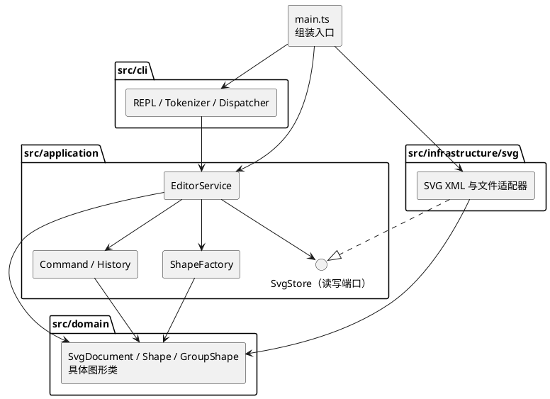

# SVG 编辑器（CLI）设计文档

> **Github仓库地址**
>
> https://github.com/dyr2045877171/SVG_Editor_Duyr.git

## 架构方案

### 模块划分与职责

本阶段以一个 TypeScript 工程实现命令行 SVG 编辑器。下表是**计划中的目录**，实现结束后再在“一致性自查”中核对实际目录。一类一文件，文件名与类名一致；类型接口可与其主要实现放在同一模块。

| 模块（计划目录） | 职责 | 不负责的事 |
| --- | --- | --- |
| `src/domain/` | `SvgDocument` 管理画布、图形树和全局唯一 id；抽象 `Shape` 封装公共属性与操作，`GroupShape` 和五种叶子图形封装各自的几何、属性校验、移动与缩放。 | 命令文本、终端、文件路径、XML 解析和撤销栈。 |
| `src/application/` | `EditorService` 作为编辑器入口，组织文档与命令执行；`commands/` 中每种编辑操作有对应的 Command 类，`History` 管理撤销重做；`ShapeFactory` 集中处理类型名到图形类的创建；`ports/` 定义 SVG 读写接口。 | 直接读取终端或依赖 XML 库、文件系统。 |
| `src/infrastructure/svg/` | 实现 `ports/` 的读写接口：解析外部 SVG、为缺失的 id 分配唯一值并报告警告、将图形树序列化为标准 SVG；处理文件读写错误。 | 决定编辑命令和撤销重做规则。 |
| `src/cli/` | REPL 显示 `svg>`、逐行读取、忽略 `#` 注释；解析带双引号的参数；集中分发命令名；格式化成功、错误、`tree`、`show`、`help` 的文本输出。 | 保存业务状态或直接修改图形树。 |
| `src/main.ts` | 创建并连接上述对象，启动 CLI。 | 放置编辑规则。 |
| `test/` | 以命令会话和 SVG 往返读写验证关键行为与失败时的状态不变性。 | 产品运行时代码。 |

图形树以文档为根，`g` 是可包含子图形的节点；五种叶子为 `rect`、`circle`、`ellipse`、`line`、`text`。同一 `id` 在整份文档内唯一且大小写敏感。`SvgDocument` 负责查找、父子关系和顺序等树级约束，具体图形对象负责自身几何和合法属性。这样 `move`、`scale`、`set` 等命令只需找到目标并调用对象行为。

### 组件图

以下 PlantUML 图中的箭头表示源码依赖；`main.ts` 是组装入口，不承载业务逻辑。

### 设计模式及落地方式

**Command（必需）**：每条图形编辑命令由独立的命令类保存参数并执行，例如 `CreateCommand`、`MoveCommand`、`GroupCommand`。`EditorService` 校验并执行命令，成功后才交给 `History`。一条命令是一个撤销单元；复合操作如 `group` 也只入栈一次。计划使用文档状态快照保存执行前后状态：先在副本上完成编辑，成功后替换当前文档并记录快照；失败则丢弃副本，保证文档和历史都不变。`undo`、`redo` 恢复相应快照，撤销后出现新编辑则清空 redo 栈。快照方案便于可靠处理分组、删除和顺序变更，代价是历史占用随文档大小增长；本阶段先接受这一代价。

`tree`、`show`、`help` 是只读查询，不进入历史。`init`、`read`、`save` 和带参数的 `canvas` 采用文档操作流程，不作为可撤销命令；执行后按题目规则禁止 undo/redo，直到下一次成功的图形编辑。无参数 `canvas` 只是查询。

**Composite**：`Shape` 定义统一的编辑接口，叶子类操作自身，`GroupShape` 持有有序子节点并将适用的操作递归到子树。删除容器会带走子孙；`move`、`scale` 对容器整体生效；`set` 由目标对象校验和处理自身允许的属性。`group`、`ungroup`、`addto` 和层级调整由文档维护父子关系、顺序及防循环约束。

**Factory**：`ShapeFactory` 是唯一的图形类型名分派点，创建内置的六种图形，也供 SVG 读取时按标签生成对应对象。未注册的类型统一报错。命令名到实现的分派只放在 CLI 的 `Dispatcher`；项目其他位置不以分散的 `switch(tag)` 决定图形行为。这两处按名字分派是本阶段允许的架构待重构点，后续可改为注册机制。

**Port/Adapter**：应用层只依赖 `SvgStore` 读写接口，SVG/XML 与文件系统实现留在基础设施层。`read` 先完整解析和验证，再替换当前文档；`save` 通过接口输出浏览器可打开的 SVG。这样 CLI、编辑规则与具体 XML 库之间没有直接依赖。

### 依赖方向规则

| 发起模块 | 允许依赖 | 理由 |
| --- | --- | --- |
| `domain` | 同模块代码；TypeScript 标准能力 | 图形规则不需要知道界面、命令和存储方式。 |
| `application` | `domain`、本模块的 `ports` | 用领域对象完成用例，并通过接口请求持久化。 |
| `infrastructure/svg` | `domain`、`application/ports` | 适配领域对象并实现应用所需的存储接口。 |
| `cli` | `application` 暴露的入口与结果类型 | CLI 只翻译输入输出，不绕过应用层改模型。 |
| `main.ts` | 上述各模块 | 仅在组装入口创建具体适配器和服务。 |

特别禁止 `domain → application/cli/infrastructure`、`application → cli/infrastructure`、`cli → domain/infrastructure` 的直接导入；基础设施层也不能反向调用 CLI。实现后将抽样检查 import 关系；任何偏离都要在修订记录中说明并处理。

### 未来变化点假设

| 可能的变化 | 本阶段的决定 |
| --- | --- |
| 增加图形类型，特别是后续阶段的插件式 `box` | 图形行为放在各自类中，类型名创建集中在 `ShapeFactory`。本阶段只实现六种内置类型，**不实现 `box` 或 `ShapeProvider` 插件系统**；类型注册、插件属性传播及读回还原留待后续重构。 |
| 增加 CLI 以外的操作入口，例如 agent 或图形界面 | `EditorService` 提供不依赖终端的用例入口；新增入口可复用应用与领域层。当前不预先实现其他界面。 |
| 更换 SVG 解析库、增加存储来源 | `SvgStore` 隔离读写实现；当前只提供本地 SVG 文件适配器，不设计尚无需求的多格式导出。 |
| 文档变大导致撤销历史占用过高 | `History` 独立于具体编辑命令；若测到实际压力，再将全量快照改为差量或反向操作。本阶段优先保证复合操作撤销的正确性。 |
| 支持更多 SVG 特性，如任意 `transform`、样式或复杂路径 | 当前命令和模型只承诺题目列出的图形与属性；不会为尚未定义的 SVG 语义建立通用渲染引擎。扩展时先补清读写和编辑规则，再修改具体图形及适配器。 |

这份方案保留实现前的设计基线。以下过程与自查依据当前代码、提交历史和测试结果填写，并与原方案对照。

## 过程记录

| 阶段 | 讨论、发现与验证 | 决定或修订 |
| --- | --- | --- |
| 先定架构（2026-10-22） | 与 AI 先讨论模块边界和课程要求，确认 Command 是必需模式、`g` 与叶子图形要有统一操作语义；把 `box` 与插件化划到后续阶段。 | 形成上面的目录、PlantUML 图和依赖规则。本阶段只实现六种内置类型。 |
| 图形与读写实现 | AI 生成的模型采用 `Shape` / `GroupShape` 类层次，`SvgDocument` 管理全局 id、树结构和顺序。集成测试中构造嵌套图形并移动容器，核对其子节点随之改变；保存后重新读取，核对图形层级和文字转义。 | 保留 Composite 结构；读取缺 id 的外部 SVG 时先收集已存在 id，再自动分配，避免与后续元素撞名，并输出警告。 |
| 撤销重做实现（2026-10-23） | 分组、删除等命令会同时修改多个节点。逐条写逆操作容易遗漏父节点和原顺序；测试还要区分失败编辑、只读查询与文档操作。 | `EditorService` 在文档副本上执行 Command，成功后由 `History` 记录前后快照；失败则丢弃副本。测试了整条 `group` 一次撤销、redo 清空、以及 `save` / `read` / `init` / 修改 `canvas` 后的禁用规则。 |
| TypeScript 测试文件识别 | IDEA提示找不到 `node:assert`。检查后发现 `@types/node` 已安装，`types: ["node"]` 也已设置；实际问题是 `tsconfig.json` 的 `include` 未包含 `test/`。用 `tsc --listFilesOnly` 确认测试文件缺席。 | 将 `test/**/*.ts` 纳入 TypeScript 项目并调整 `rootDir`；再次运行类型检查和测试通过。这说明不能只按报错提示重复安装依赖，应先确认文件是否被项目配置包含。 |
| 架构复核（2026-10-26） | 对照原定依赖规则抽查 import 与类型分派，当时发现 CLI 跨层导入、适配器依赖具体工厂、额外图形分派和领域层 XML 输出四处偏差。 | 保留原方案作为基线，不追认偏差为新规则；将其记录为待处理项，后续重构后再更新自查结论。 |
| 架构整改（2026-10-27） | 以最初架构方案为基线，逐项核对了之前记录的四处偏差，而非修改原规则。 | CLI 数字解析移入 `Tokenizer`；`SvgShapeCreator` 端口隔离具体工厂；SVG 标签参数规则集中到 `ShapeFactory`；`SvgSerializer` 接管 XML 输出。编译、测试和 import 抽查后更新下节自查。 |
| 撤销反馈修正（2026-10-27） | 向AI指出撤销 `set title text` 后提示仍显示修改后的内容。检查快照发现状态已恢复，但原反馈被重复显示。 | 改为显示恢复后的图形摘要，并增加回归测试确认 `show title` 与 undo/redo 提示一致。 |

## 一致性自查

### 初次自查（2026-10-26）

#### 模块划分

实际目录包含 `src/domain/`、`src/application/`（含 `commands/`、`ports/`）、`src/infrastructure/svg/`、`src/cli/`、`src/main.ts` 与 `test/`，与架构方案的目录划分一致。新增的 `History.ts`、`Numbers.ts`、`Xml.ts` 分别放在应用层和领域层，没有引入方案外的顶层模块。因此**目录划分没有需要修订的差异**。

职责落实并非完全一致：当前 `Shape`、具体图形类和 `SvgDocument` 中包含 `toSvg`，`domain/Xml.ts` 负责 XML 转义，而原方案把 SVG 序列化归于 `infrastructure/svg/`。这是实现偏差，尚未重构。

#### 依赖方向与设计规则

抽样检查了 `src/` 下的 import。领域层未发现向 CLI、应用层或基础设施层的反向导入；应用层也未直接导入 CLI 或基础设施层。发现以下偏差项：

| 位置 | 与原方案不一致之处 | 后续处理方向 |
| :-- | :-- | :-- |
| `src/cli/CommandDispatcher.ts` | 直接导入 `domain/Numbers.ts` 的 `parseNumber`，违反“CLI 只依赖 application”。 | 将命令文本的数字解析留在 CLI 内，或让应用入口接收原始参数并负责解析，移除该跨层导入。 |
| `src/infrastructure/svg/SvgFileStore.ts` | 直接导入具体的 `application/ShapeFactory.ts`，超过“基础设施只依赖 domain 与 application/ports”的规则。 | 通过端口注入图形创建能力，或调整工厂所属模块并同步修订依赖图。 |
| `src/infrastructure/svg/SvgFileStore.ts` 的 `parseShape` | 另有按 SVG 标签名分派的 `switch`；任务规定按名字分派只能在命令分发与图形工厂两处。 | 把 SVG 属性转换为普通参数后交给图形工厂，使类型分派收敛到工厂。 |

### 已作出的修改（2026-10-27）

| 初次自查发现的问题 | 修改 |
| --- | --- |
| CLI 直接使用领域层的数字解析函数 | 在 `Tokenizer` 中处理 CLI 数字参数，`CommandDispatcher` 不再导入 `domain/Numbers`。 |
| SVG 适配器依赖具体 `ShapeFactory` | 在 `application/ports/` 增加 `SvgShapeCreator`；`main.ts` 创建工厂并注入 `SvgFileStore`，适配器只引用端口。 |
| `SvgFileStore` 按图形标签再写一处分派 | 适配器只收集 XML 属性；`ShapeFactory.createFromSvg` 统一处理类型对应的参数和实例创建。 |
| 领域层拼接 SVG/XML | 增加 `infrastructure/svg/SvgSerializer.ts` 负责生成与转义 XML；图形类提供封装后的属性，删除 `domain/Xml.ts` 和领域层的 `toSvg`。 |

### 整改后复查

#### 模块划分

实际顶层目录仍是 `src/domain/`、`src/application/`（含 `commands/`、`ports/`）、`src/infrastructure/svg/`、`src/cli/`、`src/main.ts` 和 `test/`，与最初方案一致。`SvgShapeCreator` 和 `SvgSerializer` 是既有模块内部的细化，没有新增顶层模块。另外在`ports/`下面新增了`SvgShapeCreator`。

职责偏差已处理：`Shape` 和具体图形类保留属性、几何与编辑行为，`SvgDocument` 管理树；SVG 文本生成与转义由 `SvgSerializer` 负责，文件读写和 XML 解析由 `SvgFileStore` 负责。

#### 依赖方向与设计规则

| 最初方案的规则 | 整改后抽查结果 |
| --- | --- |
| `domain` 不依赖应用、CLI 和基础设施 | `domain/` 只引用同模块代码。 |
| `application` 依赖 `domain` 和本模块端口 | 应用层未导入 CLI 或基础设施。 |
| `infrastructure/svg` 依赖 `domain` 与 `application/ports` | `SvgFileStore` 通过 `SvgShapeCreator` 使用工厂，不引用具体 `ShapeFactory`。 |
| `cli` 只依赖应用入口和同模块代码 | `CommandDispatcher` 不再导入领域层。 |
| `main.ts` 负责组装 | 在入口创建并连接工厂、SVG 适配器、应用服务和 CLI。 |

命令名分派仍在 `CommandDispatcher`；图形类型名到类及 SVG 参数规则集中在 `ShapeFactory`，适配器不再有按图形标签的 `switch`。**初次自查记录的四处偏差已处理**；本次抽查未发现违反最初依赖方向的导入。

## 质量保证手段

- **类型检查**：在项目根目录运行 `npx tsc -p tsconfig.json --noEmit`，当前通过。它覆盖 `src/` 与 `test/`，能发现 TypeScript 类型和模块引用错误。
- **命令级集成测试**：运行 `npm test`；2026-10-27 的结果为 7 组通过、0 组失败。测试从 `CommandDispatcher` 入口覆盖六种图形创建、容器嵌套，以及 `init/read/save/canvas`、`delete/move/scale/set/group/ungroup/addto/front/back`、`tree/show/help/undo/redo` 的代表性路径。
- **关键边界检查**：测试检查 SVG 保存再读回、XML 文字转义、外部 SVG 缺 id 时警告和避开已有 id；检查非法缩放与分组失败不改变树，整条复合命令只需一次撤销，只读查询不占历史，新的编辑清空 redo，文档操作后历史受限。
- **人工复核依据**：`npm run cli` 可用于手动执行任务文档中的示例命令；生成的 SVG 是纯文本，可检查 XML 结构并在浏览器中预览。当前自动测试验证了结构与读写往返，尚未将浏览器视觉效果纳入自动化验证。

这些证据支持**本阶段已实现命令的主要功能**，但 7 组测试不是所有输入组合的穷尽证明。复杂或不受支持的 SVG 特性、长会话的快照内存占用仍需单独验证；架构一致性结论限于上述目录、import 和分派位置的抽查。
