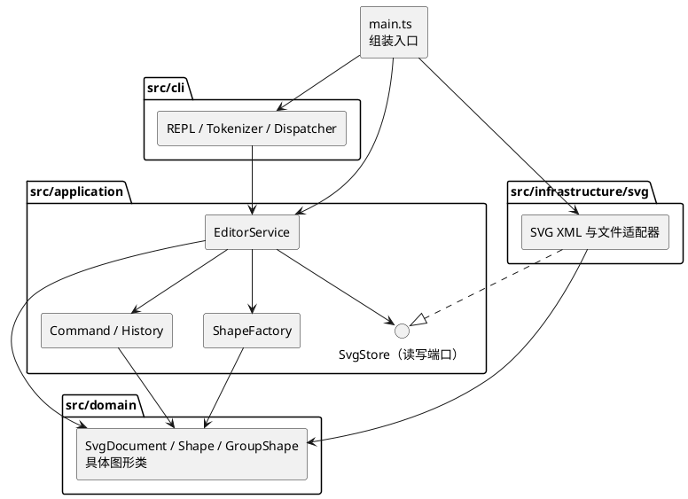

# SVG 编辑器（CLI）设计文档

## 架构方案

### 1. 模块划分与职责

本阶段以一个 TypeScript 工程实现命令行 SVG 编辑器。下表是**计划中的目录**，实现结束后再在“一致性自查”中核对实际目录。一类一文件，文件名与类名一致；类型接口可与其主要实现放在同一模块。

| 模块（计划目录） | 职责 | 不负责的事 |
|---|---|---|
| `src/domain/` | `SvgDocument` 管理画布、图形树和全局唯一 id；抽象 `Shape` 封装公共属性与操作，`GroupShape` 和五种叶子图形封装各自的几何、属性校验、移动与缩放。 | 命令文本、终端、文件路径、XML 解析和撤销栈。 |
| `src/application/` | `EditorService` 作为编辑器入口，组织文档与命令执行；`commands/` 中每种编辑操作有对应的 Command 类，`History` 管理撤销重做；`ShapeFactory` 集中处理类型名到图形类的创建；`ports/` 定义 SVG 读写接口。 | 直接读取终端或依赖 XML 库、文件系统。 |
| `src/infrastructure/svg/` | 实现 `ports/` 的读写接口：解析外部 SVG、为缺失的 id 分配唯一值并报告警告、将图形树序列化为标准 SVG；处理文件读写错误。 | 决定编辑命令和撤销重做规则。 |
| `src/cli/` | REPL 显示 `svg>`、逐行读取、忽略 `#` 注释；解析带双引号的参数；集中分发命令名；格式化成功、错误、`tree`、`show`、`help` 的文本输出。 | 保存业务状态或直接修改图形树。 |
| `src/main.ts` | 创建并连接上述对象，启动 CLI。 | 放置编辑规则。 |
| `test/` | 以命令会话和 SVG 往返读写验证关键行为与失败时的状态不变性。 | 产品运行时代码。 |

图形树以文档为根，`g` 是可包含子图形的节点；五种叶子为 `rect`、`circle`、`ellipse`、`line`、`text`。同一 `id` 在整份文档内唯一且大小写敏感。`SvgDocument` 负责查找、父子关系和顺序等树级约束，具体图形对象负责自身几何和合法属性。这样 `move`、`scale`、`set` 等命令只需找到目标并调用对象行为。

### 2. 组件图

以下 PlantUML 图中的箭头表示源码依赖；`main.ts` 是组装入口，不承载业务逻辑。

### 3. 设计模式及落地方式

**Command（必需）**：每条图形编辑命令由独立的命令类保存参数并执行，例如 `CreateCommand`、`MoveCommand`、`GroupCommand`。`EditorService` 校验并执行命令，成功后才交给 `History`。一条命令是一个撤销单元；复合操作如 `group` 也只入栈一次。计划使用文档状态快照保存执行前后状态：先在副本上完成编辑，成功后替换当前文档并记录快照；失败则丢弃副本，保证文档和历史都不变。`undo`、`redo` 恢复相应快照，撤销后出现新编辑则清空 redo 栈。快照方案便于可靠处理分组、删除和顺序变更，代价是历史占用随文档大小增长；本阶段先接受这一代价。

`tree`、`show`、`help` 是只读查询，不进入历史。`init`、`read`、`save` 和带参数的 `canvas` 采用文档操作流程，不作为可撤销命令；执行后按题目规则禁止 undo/redo，直到下一次成功的图形编辑。无参数 `canvas` 只是查询。

**Composite**：`Shape` 定义统一的编辑接口，叶子类操作自身，`GroupShape` 持有有序子节点并将适用的操作递归到子树。删除容器会带走子孙；`move`、`scale` 对容器整体生效；`set` 由目标对象校验和处理自身允许的属性。`group`、`ungroup`、`addto` 和层级调整由文档维护父子关系、顺序及防循环约束。

**Factory**：`ShapeFactory` 是唯一的图形类型名分派点，创建内置的六种图形，也供 SVG 读取时按标签生成对应对象。未注册的类型统一报错。命令名到实现的分派只放在 CLI 的 `Dispatcher`；项目其他位置不以分散的 `switch(tag)` 决定图形行为。这两处按名字分派是本阶段允许的架构待重构点，后续可改为注册机制。

**Port/Adapter**：应用层只依赖 `SvgStore` 读写接口，SVG/XML 与文件系统实现留在基础设施层。`read` 先完整解析和验证，再替换当前文档；`save` 通过接口输出浏览器可打开的 SVG。这样 CLI、编辑规则与具体 XML 库之间没有直接依赖。

### 4. 依赖方向规则

| 发起模块 | 允许依赖 | 理由 |
|---|---|---|
| `domain` | 同模块代码；TypeScript 标准能力 | 图形规则不需要知道界面、命令和存储方式。 |
| `application` | `domain`、本模块的 `ports` | 用领域对象完成用例，并通过接口请求持久化。 |
| `infrastructure/svg` | `domain`、`application/ports` | 适配领域对象并实现应用所需的存储接口。 |
| `cli` | `application` 暴露的入口与结果类型 | CLI 只翻译输入输出，不绕过应用层改模型。 |
| `main.ts` | 上述各模块 | 仅在组装入口创建具体适配器和服务。 |

特别禁止 `domain → application/cli/infrastructure`、`application → cli/infrastructure`、`cli → domain/infrastructure` 的直接导入；基础设施层也不能反向调用 CLI。实现后将抽样检查 import 关系；任何偏离都要在修订记录中说明并处理。

### 5. 未来变化点假设

| 可能的变化 | 本阶段的决定 |
|---|---|
| 增加图形类型，特别是后续阶段的插件式 `box` | 图形行为放在各自类中，类型名创建集中在 `ShapeFactory`。本阶段只实现六种内置类型，**不实现 `box` 或 `ShapeProvider` 插件系统**；类型注册、插件属性传播及读回还原留待后续重构。 |
| 增加 CLI 以外的操作入口，例如 agent 或图形界面 | `EditorService` 提供不依赖终端的用例入口；新增入口可复用应用与领域层。当前不预先实现其他界面。 |
| 更换 SVG 解析库、增加存储来源 | `SvgStore` 隔离读写实现；当前只提供本地 SVG 文件适配器，不设计尚无需求的多格式导出。 |
| 文档变大导致撤销历史占用过高 | `History` 独立于具体编辑命令；若测到实际压力，再将全量快照改为差量或反向操作。本阶段优先保证复合操作撤销的正确性。 |
| 支持更多 SVG 特性，如任意 `transform`、样式或复杂路径 | 当前命令和模型只承诺题目列出的图形与属性；不会为尚未定义的 SVG 语义建立通用渲染引擎。扩展时先补清读写和编辑规则，再修改具体图形及适配器。 |

这份方案是实现前的设计基线。过程记录、一致性自查和质量保证手段将在对应工作发生后据实填写，不提前写成已完成的结果。
